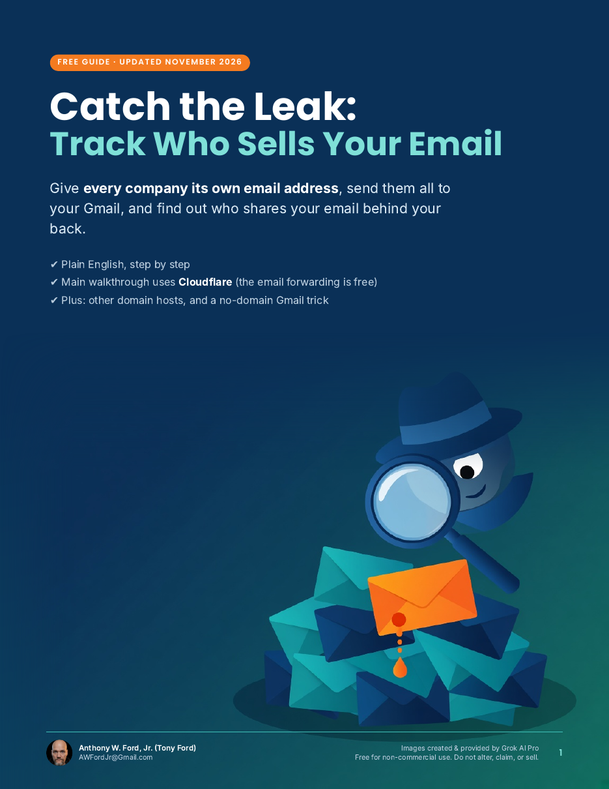
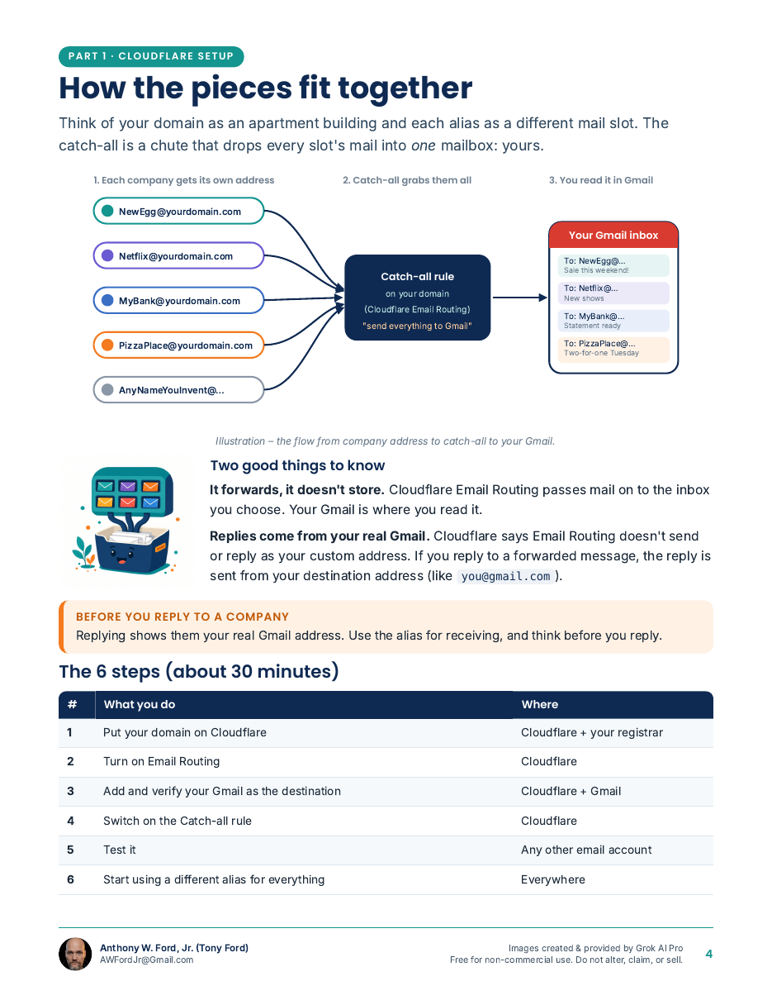
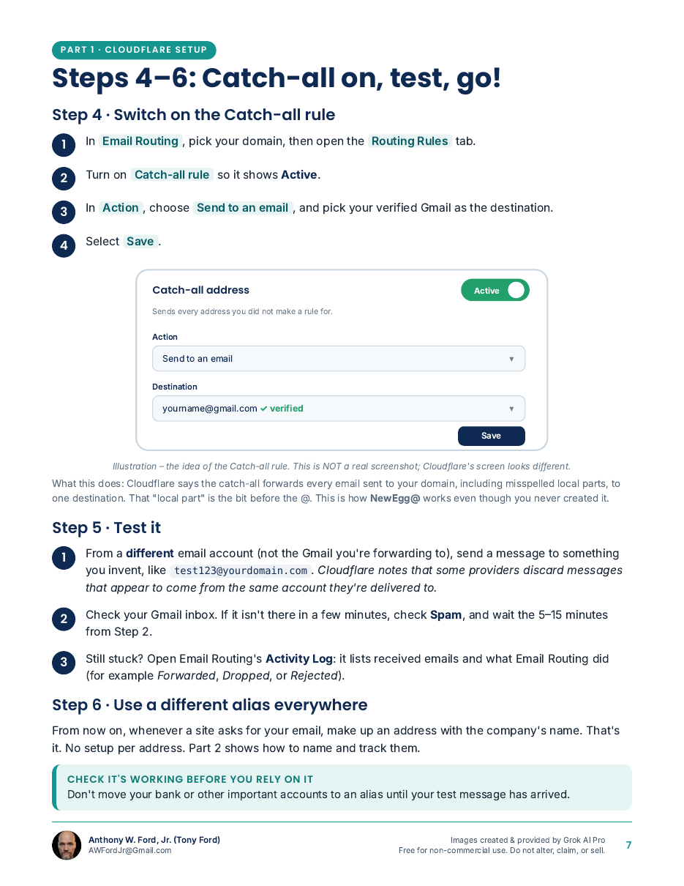
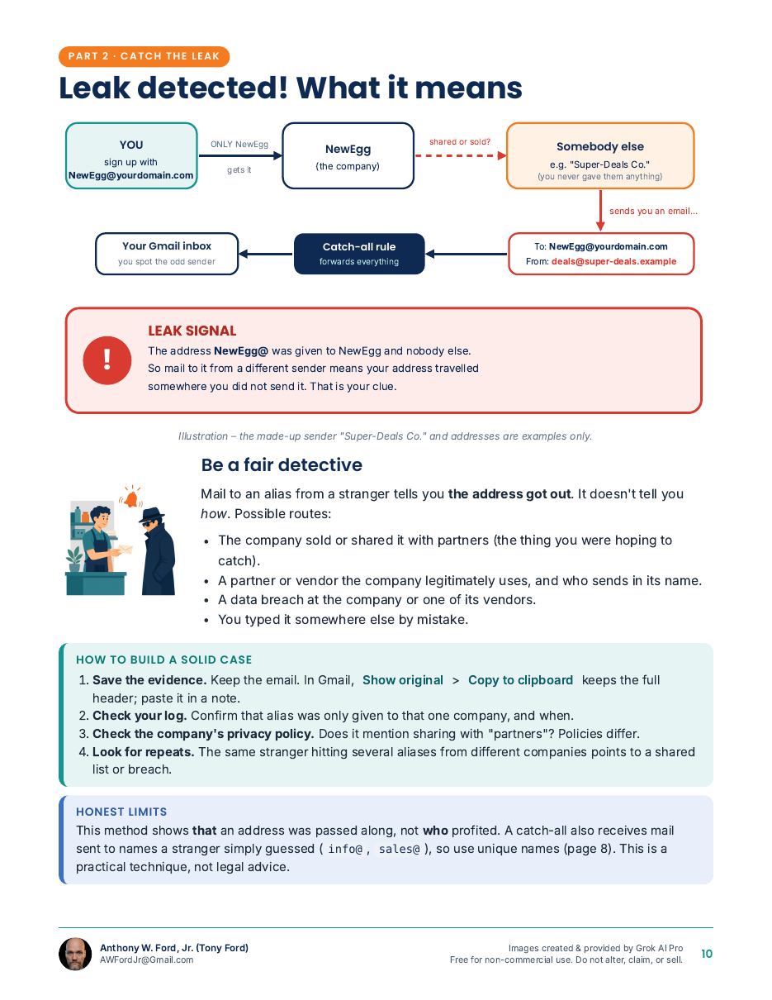

# Catch the Leak: Track Who Sells Your Email

**By Anthony W. Ford, Jr. (Tony Ford)** · awfordjr@gmail.com

### 📥 [Download the free PDF guide (17 pages)](Catch-the-Leak-Email-Catch-All-Guide-by-Tony-Ford.pdf)

## The idea in one minute

Most of us give the same email address to everyone. When the spam starts, we have no idea who let it out.

So instead, give **every company its own address** on a domain you own:

- `NewEgg@yourdomain.com`
- `Netflix@yourdomain.com`
- `MyBank@yourdomain.com`

A free **catch-all** setting sends every one of them to your normal Gmail. You never have to create the addresses first; just make one up when you sign up.

If mail sent to `NewEgg@yourdomain.com` shows up from anyone **other than NewEgg**, you know exactly who shared your email. 🕵️

## A note from me

This is my own original idea, and I've been doing it for years, mostly with other domain hosts. Today I use **Cloudflare** for all my domains because its email forwarding is free and simple, so that's what this guide walks you through.

This guide was made by **Grok AI Pro** from my prompts, and she deserves full credit for it. The idea and the years of doing it are mine; Grok turned them into the simplest steps and pictures so everyone can understand and follow it.

## What's inside

- **Part 1:** Set it up with Cloudflare Email Routing, step by step (free)
- **Part 2:** Catch the leak: naming your aliases, keeping a log, Gmail filters and labels, and what to do when an alias leaks
- **Part 3:** Other domain hosts (Namecheap, Porkbun, GoDaddy, Google Workspace, Zoho, Microsoft 365) and a free no-domain Gmail trick
- **Extras:** FAQ, a one-page checklist, and sources

## Credits

Guide made by Grok AI Pro from Tony Ford's prompts. Images created & provided by Grok AI Pro. Illustrations are drawings, not real screenshots, so your screens may look a little different.

## License

Free for non-commercial use. Share the unchanged PDF freely. No changes, no rebranding, no credit-taking, no selling or profit. (CC BY-NC-ND 4.0)

© 2026 Anthony W. Ford, Jr. (Tony Ford) · awfordjr@gmail.com
