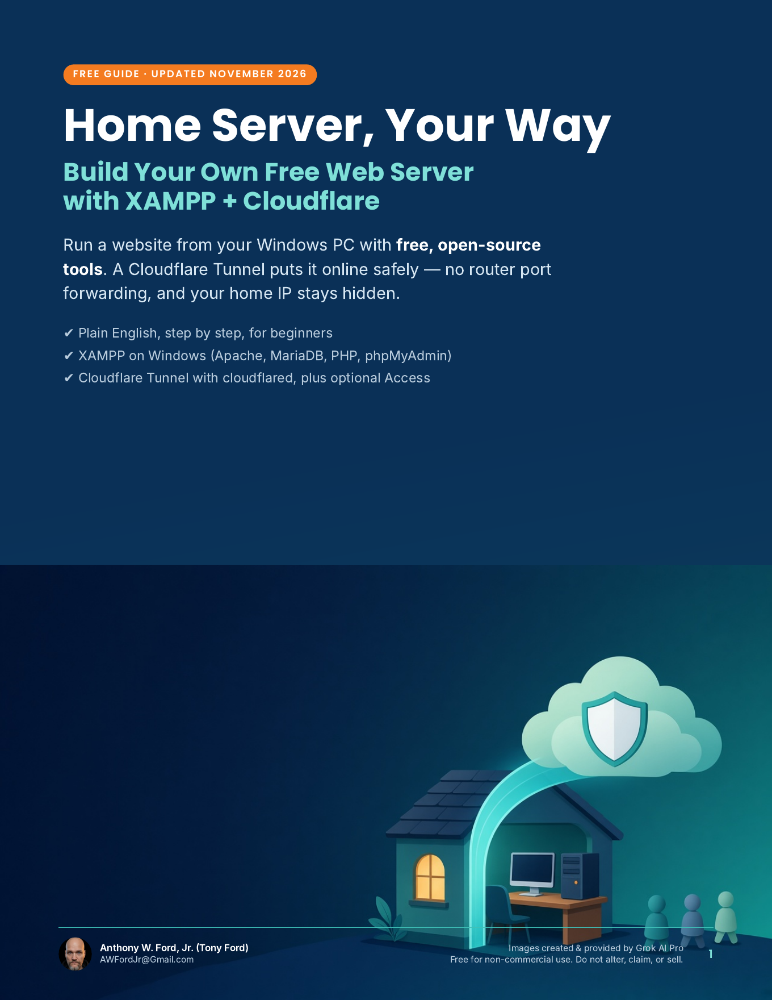
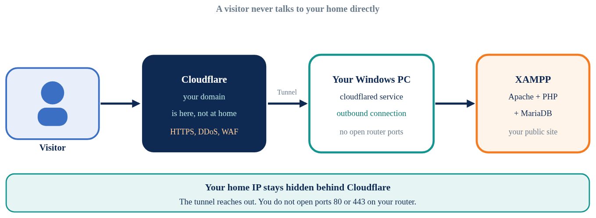
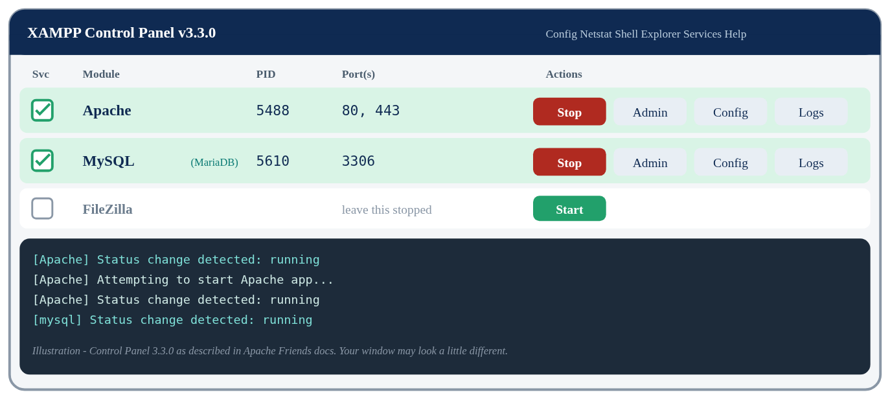
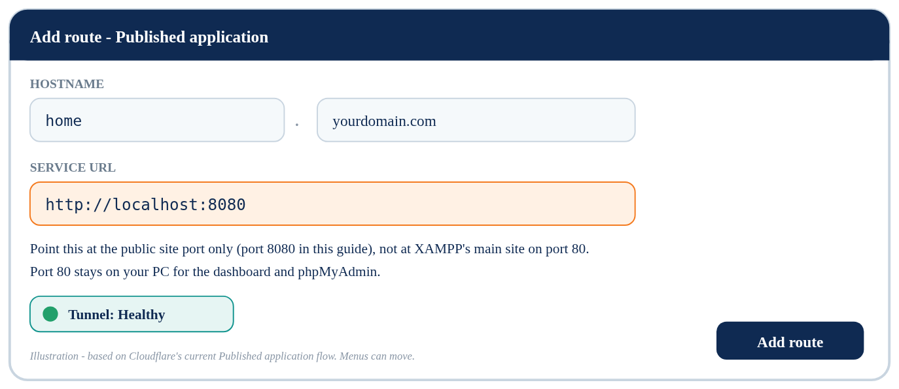

# Home Server, Your Way: Build Your Own Free Web Server with XAMPP + Cloudflare

**By Anthony W. Ford, Jr. (Tony Ford)** · awfordjr@gmail.com

### 📥 [Download the free PDF guide (21 pages)](Home-Server-Your-Way-by-Tony-Ford.pdf)

> [!WARNING]
> **Read this first: only do this if you'll keep your domain.** Your public website address only works while you own the domain. If you forget to renew it, or decide you don't want it anymore, someone else can buy it and put whatever they want at that name — including a fake version of your site. If you also use the domain for email, the new owner can receive password resets and account alerts too. If you ever plan to let a domain go, first take the site down and move every account off it. Only do this if you'll keep the domain paid, turn on auto-renew, and keep a list of what you tied to it.

## The idea in one minute

You can run a real website from the Windows PC you already have. **XAMPP** (a free installer from Apache Friends) gives you Apache, MariaDB, PHP, and phpMyAdmin. A **Cloudflare Tunnel** then carries visitors to that server through Cloudflare, so you don't open ports on your router.

Visitors type your domain, land on Cloudflare, and Cloudflare sends the request down the tunnel to XAMPP. Your home IP stays hidden. That's a privacy win, and it's why I use this method.

## A note from me

I use Windows, and I use **Cloudflare** for all of my domains. This guide walks you through a careful home setup: passwords, admin tools kept off the public port, a tunnel so you don't poke holes in your router, and optional Cloudflare Access if the site is just for you or a small group.

XAMPP is built for development, not as a hardened production server. This is a clear way to put a simple personal or practice site online — not a license to host other people's private data, take payments, or skip your internet provider's rules.

This guide was made by **Grok AI Pro** from my prompts, and she deserves full credit for it. The idea and the way I run things are mine; Grok turned them into the simplest steps and pictures so everyone can understand and follow it. Every step was checked against official documentation in November 2026.

## What's inside

- **Before you begin:** What computer do you need? Official requirements, plus practical recommendations by the kind of site you share
- **Part 1:** Install XAMPP on Windows, start Apache and MySQL, and fix port 80/443 conflicts
- **Part 2:** Your first site (a test page, then a tiny PHP check you delete)
- **Part 3:** Secure it: set a MariaDB root password, and keep phpMyAdmin and the dashboard off the public port
- **Part 4:** Put it online with a Cloudflare Tunnel (cloudflared as a Windows service), plus optional Access
- **Part 5:** Keep it running (sleep, power, backups, ISP terms, the domain) — and let free sites carry the heavy files (YouTube, GitHub, SourceForge)
- **Extras:** Troubleshooting, FAQ, a one-page checklist, and sources

## Credits

Guide made by Grok AI Pro from Tony Ford's prompts. Images created & provided by Grok AI Pro. Illustrations are drawings, not real screenshots, so your screens may look a little different.

## License

Free for non-commercial use. Share the unchanged PDF freely. No changes, no rebranding, no credit-taking, no selling or profit. (CC BY-NC-ND 4.0)

© 2026 Anthony W. Ford, Jr. (Tony Ford) · awfordjr@gmail.com
